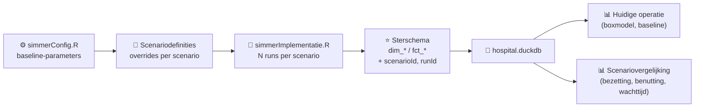

```
 /$$$$$$$  /$$$$$$$$  /$$$$$$  /$$$$$$$  /$$      /$$ /$$$$$$$$
| $$__  $$| $$_____/ /$$__  $$| $$__  $$| $$$    /$$$| $$_____/
| $$  \ $$| $$      | $$  \ $$| $$  \ $$| $$$$  /$$$$| $$      
| $$$$$$$/| $$$$$   | $$$$$$$$| $$  | $$| $$ $$/$$ $$| $$$$$   
| $$__  $$| $$__/   | $$__  $$| $$  | $$| $$  $$$| $$| $$__/   
| $$  \ $$| $$      | $$  | $$| $$  | $$| $$\  $ | $$| $$      
| $$  | $$| $$$$$$$$| $$  | $$| $$$$$$$/| $$ \/  | $$| $$$$$$$$
|__/  |__/|________/|__/  |__/|_______/ |__/     |__/|________/
Theme Hospital • Scenario's voor het meerjarig beleidsplan
```

### 0. Project management en setup

#### Governance
[Github project](https://github.com/users/ChrismaxR/projects/3/views/18?sliceBy%5Bvalue%5D=Epic)
[Github repo](https://github.com/ChrismaxR/DataBA/tree/main)

Zie [Fasering.md](Fasering.md) voor het implementatieplan.

### 1. Context: de COO is "in control"

Dr. Van Dalen, COO van Theme Hospital, heeft haar standaardrapportage op orde. Ze weet hoe het ziekenhuis vandaag draait:

- **Bezetting & benutting** van behandelkamers en personeel
- **Wachttijden** per kamer en per aandoening
- Patiënttevredenheid, medewerkerstevredenheid en financiële balans *(buiten scope van dit project)*

Met die rapportage kan een **boxmodel** van de huidige operatie worden opgezet. Het boxmodel laat zien hoe patiënten door het ziekenhuis stromen (Receptie → Diagnose → Behandeling), met welke kansen ze een route volgen en waar de capaciteit knelt.

### 2. Het probleem: hoe ziet de toekomst eruit?

Dr. Van Dalen schrijft een **meerjarig beleidsplan**. Daarvoor moet ze weten hoe de operatie zich houdt als zorgvraag en zorgaanbod veranderen:

> *"Welke toekomstige situaties moet ik aankunnen, en wat doen die met bezetting, benutting en wachttijden, gegeven mijn behandelcapaciteit?"*

Dit project levert de input voor dat plan. Een discrete-event simulatie (R/`simmer`) wordt gekalibreerd op de huidige operatie (baseline 2026) en daarna doorgerekend onder verschillende scenario's (2027 en verder).

Informatiebehoefte:
1. Hoe ziet de huidige operatie eruit als boxmodel (stromen, routekansen, knelpunten)?
2. Wat gebeurt er met bezetting, benutting en wachttijden per scenario?
3. Welke behandelkamers worden als eerste een knelpunt, en wanneer?
4. Hoeveel extra (of herverdeelde) capaciteit is nodig om wachttijden onder norm X te houden?
5. Hoe groot is de onzekerheid rond die uitkomsten (bandbreedte over vele simulatieruns)?

### 3. Scenario's

| # | Scenario | Wat verandert er | Instelling in `simmerConfig.R` |
|---|----------|------------------|--------------------------------|
| 0 | **Baseline 2026** | Huidige operatie | standaardwaarden |
| 1 | **Verschuiving in ziekten** | Meer welvaarts- en ouderdomsziekten, dus een andere mix van aandoeningen en routes | gewichten in `aandoeningDimensies` |
| 2 | **Infectieziekten** | Epidemische golven van één of meer infectieziekten (geen pandemieën) | `epidemie_*` (piek, duur, gewicht, aantal golven) |
| 3 | **Grotere en grilligere patiëntenpopulatie** | Hogere en minder voorspelbare toeloop | `aankomst_schema` + spreiding van de aankomstverdeling |
| 4 | **Arbeidsmarktkrapte** | Permanent of tijdelijk tekort aan specifiek zorgpersoneel, dus minder beschikbare kamers | `resource_definitie` (permanent) / `capaciteit_schema` (tijdelijk) |

Voor 2027 worden eerst **scenario 3 en 4** uitgewerkt; scenario 1 en 2 volgen later.

Elk scenario wordt **vele keren** gesimuleerd met verschillende seeds. Zo zie je naast een gemiddelde ook een bandbreedte (bijv. P10–P90).

### 4. Waarom deze data?

- Theme Hospital ❤️ Wat was Theme Hospital ook al [weer](https://www.nme.com/features/gaming-features/why-theme-hospital-is-the-greatest-of-the-simulation-satires-3096680)?

> "De synthetische dataset is afgeleid van een discrete-event simulatie.
> Operationele afhankelijkheden (zoals kamerbeschikbaarheid) worden opgelost tijdens datageneratie.
> De fact-tabellen representeren analytische snapshots en zijn niet bedoeld als transactielog."

### 5. Architectuur



### 6. Projectstructuur

```
src/
  generateScripts/
    simmerConfig.R          # single source of truth: kamers, aandoeningen, schema's
    simmerImplementatie.R   # discrete-event simulatie -> sterschema-tibbles
  databaseScripts/
    databaseUtils.R         # schrijft dim_/fct_-tabellen naar hospital.duckdb
  sqlScripts/               # conceptqueries op het sterschema

dashboard/                  # Evidence.dev site (leest hospital.duckdb)
  pages/
  sources/hospital/         # SQL-bronnen + hospital.duckdb

docs/                       # mapping-tabellen, user stories, datamodel (drawio)
oud/                        # gearchiveerde scripts
```

### 7. Hoe lokaal draaien

```r
# In één R-sessie, vanuit de projectroot
source("src/generateScripts/simmerImplementatie.R")  # sourcet simmerConfig.R zelf
source("src/databaseScripts/databaseUtils.R")        # schrijft hospital.duckdb
```

```bash
cd dashboard
npm run sources    # databronnen verversen
npm run dev        # dev-server met auto-refresh
npm run build      # productie-build
npm run preview    # preview van productie-build
```

### 8. Key metrics & aannames

| Metric | Definitie |
|--------|-----------|
| Bezetting | gemiddeld aantal bezette kamers / beschikbare kamers tijdens werktijd |
| Benutting | behandeltijd / beschikbare kamertijd |
| Wachttijd | tijd tussen aankomst in de wachtrij en start behandeling (P50 / P90) |
| Doorlooptijd | tijd van aankomst tot ontslag |
| % binnen norm | aandeel patiënten met wachttijd < X |

Aannames: werkdag van 8 uur, onafgemaakte behandeling loopt door naar de volgende werkdag, iedere patiënt volgt Receptie → Diagnose → Behandeling.

### 9. Dashboard screenshots

_TODO_

### 10. Wat ik nog zou verbeteren

- Priority queueing (spoedgevallen)
- Meerdere stakeholders met tegenstrijdige belangen
- Kosten per scenario (koppeling met financiële balans)
- Optimalisatie: minimale capaciteit om binnen norm te blijven
