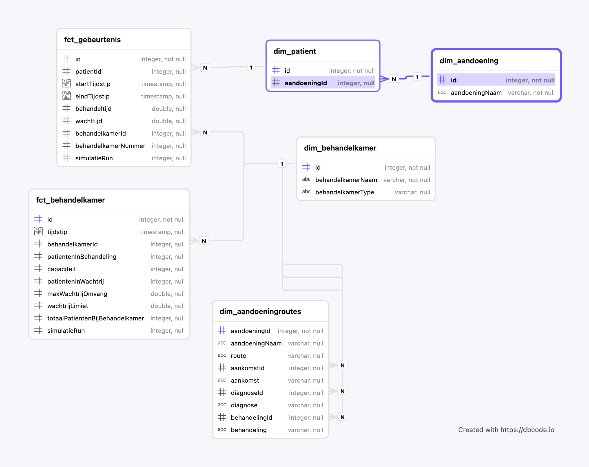

# Verantwoording

## Werkwijze in dit project

Elke stap is vastgelegd als story met vooraf benoemde op te leveren artefacten (zie `docs/`). Van probleem naar dashboard in vijf fasen:

  {#each fasen as f}
    

      

        {f.nr}
        {f.stories}
      

      
{f.fase}

      
{f.periode}

      
{f.wat}

      
Keuze: {f.keuze}

    

  {/each}

  {#each principes as p}
    {p}
  {/each}

---

## Tech stack

- R -> Applicatie
  - Simmer (R) -> Simulatie library
- DuckDB -> Database
- Evidence -> open source BI-as-Code tool
- Version Control -> Git

--- 

## App architectuur

---

## Gegevensarchitectuur

---

## Literatuur

<Grid cols=4>

</Grid>

---