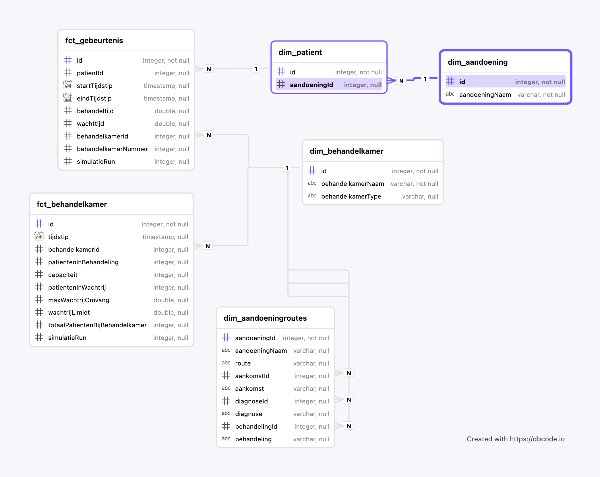

# Architectuur

# Gegevensarchitectuur

# Techstack

- R/tidyverse -> Applicatie
- Simmer -> Discrete event simulatie software
- DuckDB -> Database
- Evidence -> open source BI-as-Code tool

# Literatuur

<Grid cols=4>

</Grid>